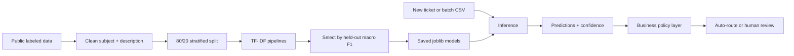

# Relay

### Support ticket intelligence with human review built in

[](https://www.python.org/)
[](https://streamlit.io/)
[](https://fastapi.tiangolo.com/)
[](https://docs.pytest.org/)

Relay is an end-to-end machine-learning application for customer-support ticket triage. It classifies incoming tickets, estimates confidence, applies explicit business rules, and routes uncertain or high-impact cases to a human review queue.
The project includes a Streamlit operations dashboard, a FastAPI inference service, reproducible training scripts, a batch CSV workflow, evaluation reports, and documentation for responsible use.

> **Demo-ready:** Relay runs locally without API keys, Docker, or a network connection when the included model artifacts are present.

## Highlights

- **Human-in-the-loop by design:** low-confidence, security-sensitive, and configured categories can be routed to review.
- **Two ways to use it:** a polished Streamlit workspace for operators and a FastAPI endpoint for integrations.
- **Auditable decisions:** every policy override is represented in the final decision and explanation.
- **Inference-only runtime:** the dashboard loads saved models and never retrains from an uploaded CSV.
- **Reproducible ML workflow:** dataset download, cleaning, training, evaluation, and model-card documentation are included.

## What it does

- Predicts ticket **category**, **priority**, **queue**, and **sentiment**.
- Produces calibrated confidence signals for routing and review.
- Applies auditable JSON-backed policy overrides after model inference.
- Supports individual tickets and batch CSV uploads.
- Keeps human review as a first-class workflow instead of silently automating uncertain decisions.
- Runs locally without an API key or external AI service once the model artifacts are available.

## Quick start

Requires Python 3.10 or newer.

```bash
git clone <your-repository-url>
cd triage
python -m venv .venv
source .venv/bin/activate       # Windows: .venv\Scripts\Activate.ps1
python -m pip install --upgrade pip
python -m pip install -r requirements.txt
streamlit run app.py
```

Open the local URL printed by Streamlit, usually `http://localhost:8501`.
The repository includes the four generated model artifacts required by the demo. If `models/` is empty or incomplete, download the public datasets and train the models first:

```bash
python scripts/download_dataset.py
python scripts/train.py
```

Run the test suite with:

```bash
python -m pytest -q
```

## Deploy on Streamlit Community Cloud

1. Push this repository to GitHub, including the files in `models/`.
2. Create an app at [share.streamlit.io](https://share.streamlit.io/).
3. Select the repository and branch, then set **Main file path** to `app.py`.
4. Deploy. No secrets or API keys are required for the included demo.

The model artifacts are intentionally versioned because the app needs them at
startup. The raw training CSVs are ignored by Git and can be recreated with
the training commands above.

## Try the demo

1. Open **Tickets -> New Ticket** and analyze a ticket.
2. Open **Tickets -> Ticket Queue** to inspect review-required tickets.
3. Open **Tickets -> Batch Analysis** and upload [examples/batch_tickets.csv](examples/batch_tickets.csv).
4. Open **Intelligence -> Models** to view held-out evaluation metrics.
5. Open **Configuration -> Business Rules** to inspect policy settings.

The batch upload expects two required columns:

```csv
subject,description
Payment failed,My payment was declined and I need help.
```

Relay validates the CSV, runs saved models in inference mode, applies policy rules, and returns a downloadable results file. Uploading a CSV never retrains a model.

## Run the API

Start the FastAPI service in a second terminal:

```bash
source .venv/bin/activate
uvicorn api:app --reload
```

The API is available at `http://127.0.0.1:8000`, with interactive documentation at `http://127.0.0.1:8000/docs`.

```bash
curl -X POST http://127.0.0.1:8000/predict \
	-H "Content-Type: application/json" \
	-d '{"subject":"Payment failed","description":"My card payment failed twice."}'
```

The response includes the model prediction, confidence signals, and final policy decision. The service also exposes `GET /health`.

## System design



### Training

Training compares TF-IDF with Logistic Regression and calibrated LinearSVC candidates. The winner for each target is selected by held-out macro F1, saved under `models/`, and evaluated in `reports/metrics.json`.

### Inference

The application loads saved pipelines and predicts from the ticket `subject` and `description`. It does not fit models during normal use. Policy rules run after prediction and can raise priority, override a queue, or require human review.

## Data and evaluation

Category, priority, and queue models use [`Prady06/customer-support-tickets`](https://huggingface.co/datasets/Prady06/customer-support-tickets), a public synthetic IT support-ticket dataset. Sentiment uses [`SetFit/sst2`](https://huggingface.co/datasets/SetFit/sst2), a public Stanford Sentiment Treebank-derived dataset.

The current reproducible run uses 40,280 cleaned and deduplicated support records with an 80/20 stratified train/test split:

| Target    | Held-out accuracy | Macro F1 |
| --------- | ----------------: | -------: |
| Category  |             0.849 |    0.850 |
| Priority  |             0.581 |    0.569 |
| Queue     |             0.561 |    0.539 |
| Sentiment |             0.779 |    0.779 |

Only intake text is used as a feature. Answer text, assigned team, resolution, and other post-resolution fields are excluded to reduce label leakage. See [docs/MODELING_DECISIONS.md](docs/MODELING_DECISIONS.md), [docs/MODEL_CARD.md](docs/MODEL_CARD.md), and [reports/metrics.json](reports/metrics.json) for methodology, risks, and the full evaluation output.

## Project structure

```text
app.py                 Streamlit operations dashboard
api.py                 FastAPI inference service
relay/
	data.py              Dataset loading and cleaning
	predictor.py         Saved-model inference and validation
	policy.py            Business rules and review decisions
	ui/                  Reusable Streamlit components and styles
config/                JSON business rules
scripts/               Dataset download, exploration, and training
tests/                 Predictor, policy, batch, and API tests
data/raw/              Downloaded datasets, recreated locally
examples/              Sample batch-upload CSV files
models/                Generated joblib model artifacts
reports/               Metrics and confusion matrices
docs/                  Model, academic, and setup documentation
```

Generated datasets, logs, caches, and secrets should remain local. Keep the
saved model artifacts in `models/` when deploying the Streamlit application;
review `.gitignore` before committing.

## Development checks

Run the same checks used by continuous integration:

```bash
python -m compileall -q app.py api.py relay scripts tests
python -m pytest -q
```

The GitHub Actions workflow in `.github/workflows/ci.yml` runs the test suite
on supported Python versions for every push and pull request.

## Documentation

- [Running and setup guide](docs/guides/RUNNING.md)
- [Batch and dashboard demo script](docs/guides/DEMO.md)
- [Project map](docs/guides/PROJECT_MAP.md)
- [Model card](docs/MODEL_CARD.md)
- [Modeling decisions and leakage prevention](docs/MODELING_DECISIONS.md)
- [Academic explanation](docs/ACADEMIC_EXPLANATION.md)
- [Dataset exploration notebook](notebooks/01_data_exploration.ipynb)

## Limitations and responsible use

Relay is a decision-support system, not an autonomous replacement for support agents. The source support data is synthetic, so its taxonomy and performance may not transfer to a real organization. Priority and queue predictions are materially weaker than category predictions. Confidence is a routing signal, not a guarantee of correctness.

Before production use, validate the system on representative anonymized tickets, monitor drift and class changes, tune thresholds to review capacity, protect ticket data, and retain an auditable history of policy and human-review decisions. Low-confidence, security-sensitive, and customer-impacting tickets should receive human review.
